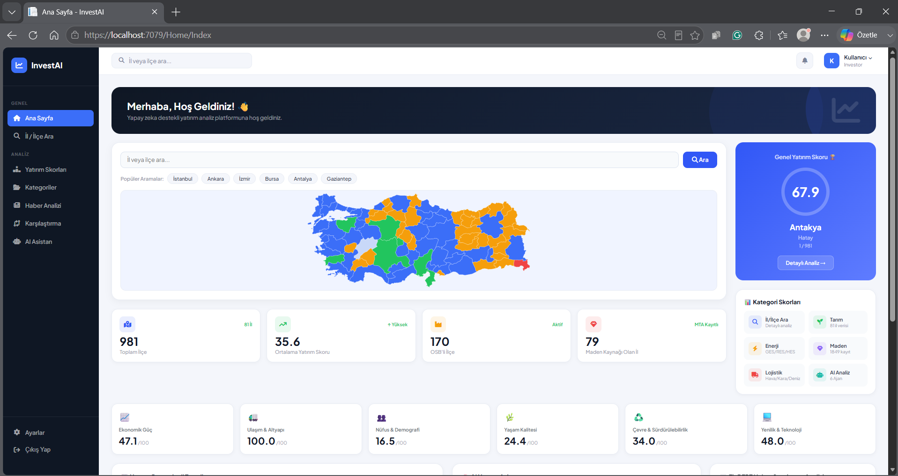
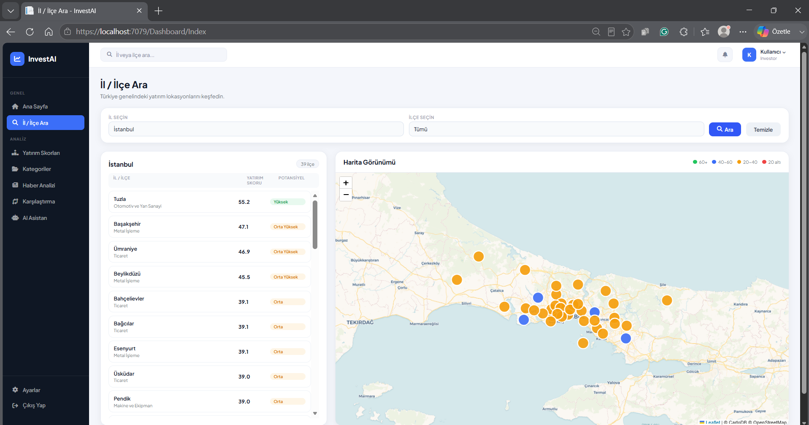
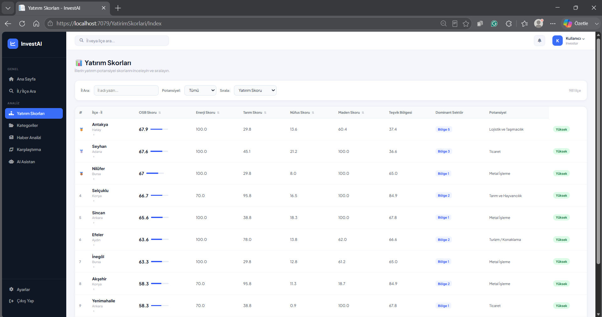
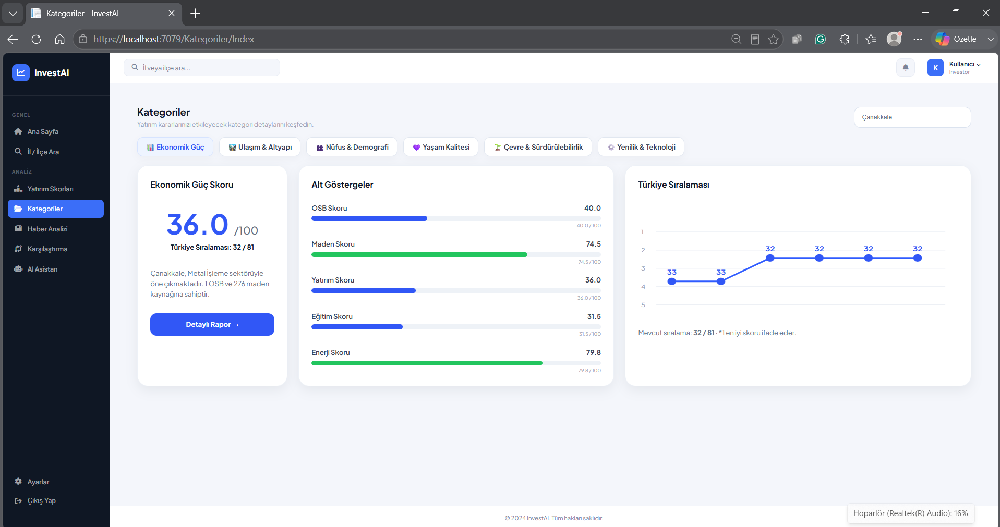
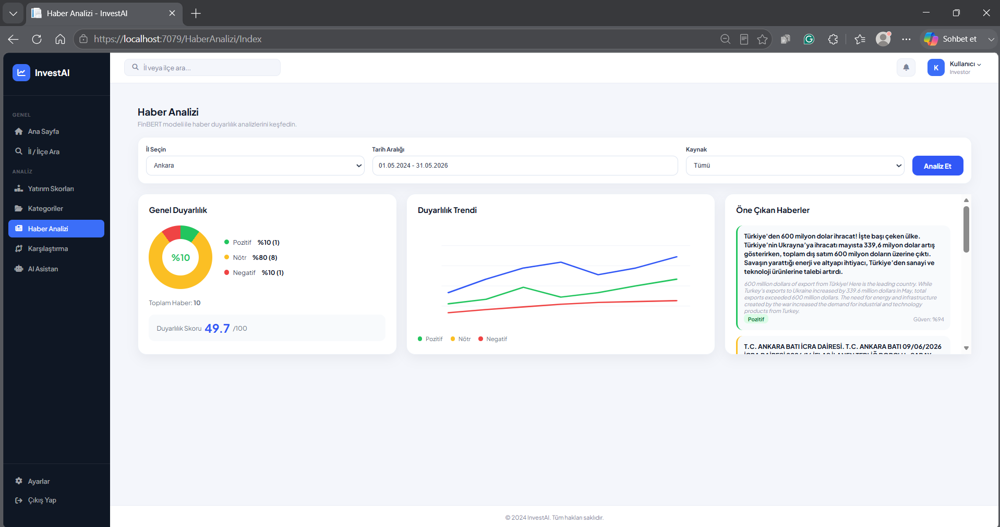
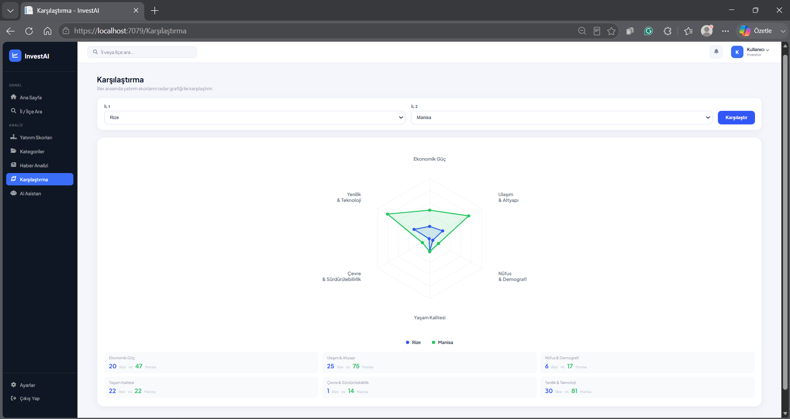
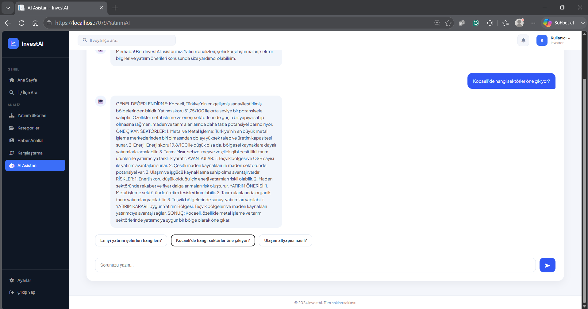

# InvestAI

## Regional Investment Analysis and Decision Support System

InvestAI is an artificial intelligence supported regional investment analysis platform developed as a graduation project. The system evaluates the investment potential of provinces and districts in Türkiye using statistical indicators, external data sources, multi-criteria decision making methods, and AI-powered analysis.

---

## Features

* Province and district based investment analysis
* Regional investment scoring system
* Artificial intelligence investment assistant
* Financial news sentiment analysis
* Infrastructure and transportation analysis
* Multi-criteria decision support
* Regional comparison module
* Interactive dashboards and visual analytics

---

## Technologies

### Backend

* ASP.NET Core MVC
* C#
* Entity Framework Core
* PostgreSQL

### Artificial Intelligence

* Ollama
* Llama 3.2
* FinBERT
* Natural Language Processing (NLP)

### Frontend

* Razor Views
* HTML
* CSS
* JavaScript
* Bootstrap

### External Data Sources

* TÜİK
* SGK
* MTA
* YEGM
* BOTAŞ
* World Bank API
* Google Maps API
* OpenWeather API

---

## System Architecture

InvestAI follows a multi-component architecture that integrates web application development, relational database management, and artificial intelligence services.

### Application Layer
- ASP.NET Core MVC
- Razor Views
- HTML, CSS, JavaScript, Bootstrap

### Backend & Data Layer
- C# and Entity Framework Core
- PostgreSQL database
- Regional investment data processing
- Multi-criteria investment scoring

### Artificial Intelligence Layer
- Python FastAPI microservice
- Ollama-based large language model integration
- Natural language investment analysis
- FinBERT-based financial news sentiment analysis

### External Data Sources
- TÜİK, SGK, MTA, YEGM, BOTAŞ
- World Bank API
- Google Maps API
- OpenWeather API

## How It Works

1. **Region Selection:** The user selects a province or district in Türkiye.

2. **Data Processing:** The system retrieves regional indicators from the PostgreSQL database.

3. **Investment Evaluation:** Regional indicators are evaluated using a weighted multi-criteria scoring approach.

4. **Results Visualization:** Investment scores and regional indicators are presented through interactive dashboards and comparison views.

5. **AI-Powered Analysis:** The AI assistant uses regional investment information to generate natural language insights.

6. **Financial News Analysis:** FinBERT is used to analyze the sentiment of financial news.

# System Screenshots

## Dashboard

---

## Project Scope

InvestAI covers all 81 provinces of Türkiye and supports province-level and district-level investment analysis. The platform combines structured regional data with artificial intelligence models to generate investment insights and recommendations.

---

## Developer

**Ceren Çokgezer**

Software Development Graduation Project

Yeditepe University
